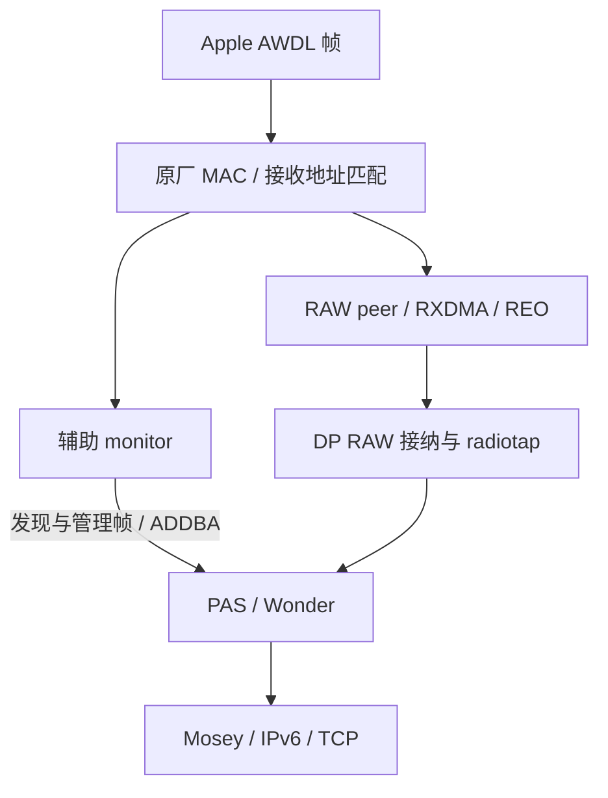

# 在 SM8750 原厂固件上实现 AWDL

OPAirShare 在 SM8750 / PJZ110 平台上采用主机侧适配，将原厂 WLAN 固件已有的 NDI、monitor、RAW 发送、接收地址过滤和 native RX 能力组合成 AWDL 无线后端。

这台设备的原厂固件缺少 WonderTap 所需的原生 PAS vdev 支持。我们保留固件，把兼容处理放在主机驱动中，再将收发接口接到 Mosey。

## 1. 平台起点：缺少的是原生 PAS 接口

研究设备使用 SM8750，WLAN 平台为 `sun` / `peach-v2`，原厂 WLAN 固件版本族为 `WLAN.GNG.1.0`。

参考平台的 WonderTap 设计通过 PAS（passthru）vdev 交换完整 802.11 帧。公开驱动中包含对应的 `QDF_PASSTHRU_MODE`、操作表和 `WMI_VDEV_TYPE_WIFI_PASSTHRU`，其固件类型值为 `9`。

在本机原厂固件上，直接创建 type 9 会触发固件断言；研发记录将其定位到固件的 vdev 类型转换路径。与此同时，原厂固件能创建 NDI vdev，宣告 NAN Data 能力，也能通过原生 monitor 接收无线帧。

实际使用的接口如下：

| 能力 | 原厂固件与驱动提供的基础 | OPAirShare 的接法 |
| --- | --- | --- |
| 上层 RAW 接口 | 主机侧 PAS / WonderTap 代码 | 维持 PAS 操作表、netdev 与原始帧语义 |
| 固件 vdev | NDI，type `7` | 作为 PAS 主机会话的固件身份 |
| 控制与发现帧发送 | 原生 mgmt_txrx / WMI TX | 传递完整 probe request 与 action 帧 |
| AWDL 数据发送 | 显式参数的 WMI RAW TX | 传递 QoS DATA，设置 `frame_type=DATA` |
| 初始接收 | 原生 monitor，type `4` | 辅助 monitor 接收并转交给 PAS 接口 |
| 接收地址配置 | 原生 MAC RX filter 命令与响应 | 写入当前 AWDL 地址、vdev 与频率 |
| 数据接收与排序 | RAW decap、peer、BA、RXDMA / REO | 建立目标 peer，协商 BA，恢复 native 数据接收配置 |
| AWDL 协议 | Mosey 原生服务与 FFI | 复用协议编码、发现和传输会话 |

研究使用设备原厂的 `amss20.bin`。

## 2. 主机与固件使用不同的接口身份

### 2.1 主机保留 PAS，固件创建 NDI

上层需要的是一个能初始化、设频、收发 RAW 帧和停止的 PAS 接口。固件则需要收到它认识的 vdev 类型。

主机与固件侧使用的类型如下：

```text
Mosey / Wonder
       │
       ▼
QDF_PASSTHRU_MODE            主机对象、操作表、netdev
       │
       ▼
WMI_VDEV_TYPE_NDI = 7        发送给固件的 CREATE 身份
```

外部平台源码 `vendor/qcom/opensource/wlan/qcacld-3.0/components/mlme/core/src/wlan_mlme_vdev_mgr_interface.c` 中的 `mlme_get_vdev_types()` 负责选择固件类型，运行模块通过 `passthru_fwtype=7` 配置这一映射。主机仍按 PAS 分派 WonderTap 的初始化、设频和数据回调。

相关代码同时检查主机模式和固件类型：

```c
host_opmode == QDF_PASSTHRU_MODE
firmware_type == WMI_VDEV_TYPE_NDI
```

### 2.2 补齐 self-peer 与 AST 映射

NDI 后端需要可用的 peer 与地址搜索表上下文。创建兼容会话时，驱动建立当前 vdev 的 DEFAULT self-peer，再通过实际 HTT peer-map 事件取得 peer ID、AST index 等映射。

self-peer 为原生 TX 框架提供当前 PAS 实例的提交上下文。后续为 Apple 对端建立的 NAN_DATA peer 则承担目标地址、RAW 接收和 BA 状态，两者分别管理。

### 2.3 将 START 响应交回 PAS 状态机

原驱动会按固件 iface type 分派 START 响应。固件身份变为 NDI 后，主机还需要将该会话的响应送回 PAS 的 channel-switch 流程。

实现中加入 PAS / NDI 组合判断，并处理 START 与 RESTART 的响应匹配：当主机只有一项请求处于 pending 时，将返回事件匹配到该请求，继续使用固件提供的 status。

相关实现位于 [wma_dev_if.c](../kernel/driver/wma_dev_if.c) 和 [target_if_vdev_mgr_rx_ops.c](../kernel/driver/target_if_vdev_mgr_rx_ops.c)。

### 2.4 沿用 NDI 的 host-only UP

正常 NDI 的 UP 流程直接完成主机状态转换。PAS 原有 monitor 回调会额外发送 `WMI_VDEV_UP`，这与 NDI 后端的生命周期不同。

适配后的流程在 PAS / NDI 组合下完成 host-only UP，后续 STOP 与 DELETE 仍沿原生固件流程执行。START 路径同时释放原本等待 UP 命令释放的 wake lock。

实现入口为 [wma_mon_mlme_vdev_up_send()](../kernel/driver/wma_utils.c)，运行参数为 `passthru_ndi_no_up=1`。

## 3. 先把完整 802.11 帧送到空口

### 3.1 从 Wonder 到 WLAN netdev

Wonder 的 mac80211 TX 回调接收完整 802.11 帧，添加 radiotap 元数据，再通过 `dev_queue_xmit()` 进入实际 PAS netdev。

HDD 的 PAS 发送入口调用 `opairshare_pas_mgmt_xmit()`，解析 radiotap 长度和 Frame Control，将需要适配的帧交给有序 bridge 工作队列。


### 3.2 从管理帧扩展到 AWDL 数据帧

最先接通的是 probe request 与 action 帧，它们承载 AWDL 发现和同步所需的无线交互。

随后出现了关键分界：NDI 后端可以完成 CREATE、START，也可以发出广播诊断帧，但原生 TCL 数据路径中的 AWDL 单播持续停留在提交阶段。单独给 peer 增加授权状态没有改变这一结果。

最终实现选择已有的 `mgmt_txrx / WMI` 提交框架，将完整 AWDL QoS 数据帧交给显式 RAW TX。发送框架和帧类型分别设置：

- `mgmt_txrx` 是主机的提交与完成框架，负责 descriptor、DMA、peer 引用及 callback。
- `mgmt.tx_param.frame_type` 描述实际发送的帧类型；AWDL QoS 数据帧使用 `DATA`。

空口上发送完整的 QoS DATA 帧，其中保留 AWDL 与 IPv6/TCP 内容。

### 3.3 精确识别 AWDL 数据

发送桥接纳的数据帧满足以下格式：

| 字段 | 条件 |
| --- | --- |
| Frame Control | `0x0088`，QoS DATA |
| DS / Protected 标志 | 对应当前无 DS、未加密的 RAW 帧布局 |
| 源地址 | 当前 PAS 实例的 MAC |
| LLC/SNAP | `aa aa 03 00 17 f2 08 00` |
| 所属 vdev | 当前 PAS 主机会话 / NDI 固件后端 |

帧内容的层次关系为：

```text
802.11 QoS Header
  └── Apple LLC/SNAP
        └── AWDL 数据封装
              └── IPv6
                    └── TCP / UDP
```

发送参数由原 WMA helper 编码，再设置：

```text
tx_params_valid = true
frame_type      = DATA
retry_limit     = 当前帧入队时记录的 attempts
bw_mask         = 20 MHz 对应的掩码
```

早期打通使用 6 Mbps，后续加入 OFDM、HT 和 VHT 速率配置。当前 fast profile 使用 VHT MCS8 / 2SS。

核心实现见 [wma_opairshare_pas_mgmt.h](../kernel/driver/wma_opairshare_pas_mgmt.h) 的 `opairshare_pas_mgmt_xmit()` 与 bridge worker。

### 3.4 按实际完成回收资源

发送队列在提交前建立 descriptor 与计数关联，原生 callback 返回后结算帧、pending 和对象引用。Stop 先排空工作队列，再删除 peer 与 vdev。

Wonder 提供给 mac80211 的本地 TX 反馈用于其上层发送逻辑；实际固件发送结果由 WMI completion 记录，空口行为由独立接收端抓包观察。研发过程分别对照这三层数据。

## 4. 接收通路

### 4.1 辅助 monitor 解决最初的 RAW 接收

原厂 monitor vdev 能提供 radiotap 与原始 802.11 帧。我们在 PAS 会话旁创建原生 monitor，令其接收结果进入同一个 PAS netdev。

辅助接收代码获取当前目标接口引用，通过 `packet_type` 接收 monitor 帧，保留 radiotap 与 802.11 内容，随后使用 `ETH_P_802_2` 和 `netif_rx()` 交给 Wonder 的接收处理器。

这一步将发现与管理帧接入原有协议栈，也建立了早期可用的数据接收通道。

实现见 [wlan_hdd_opairshare_aux_rx.h](../kernel/driver/wlan_hdd_opairshare_aux_rx.h) 与 [Wonder 接收处理](../kernel/wonder/mac80211.c)。

### 4.2 原生 RX MAC filter 配置 AWDL 接收地址

monitor 提供帧的可见性；当前 AWDL MAC 是否进入接收匹配，还需要单独配置。

原厂驱动已有：

```text
wmi_unified_set_mac_addr_rx_filter()
    └── WMI_VDEV_ADD_MAC_ADDR_TO_RX_FILTER_CMDID
```

该命令携带 `vdev_id`、MAC、频率与 set/clear。OPAirShare 将当前 PAS / NDI 会话的 MAC 和 5745 MHz 下发给原厂固件，使用已注册的 P2P 事件处理路径接收响应。

这个响应的状态约定为 `1 = success`、`0 = rejected`。驱动在响应成功后将 matcher 标记为 active，并重新开放发送队列。

同配置前后对照中，研发记录观察到 Mac→手机的重传明显减少，以及发给 Mac 的 ACK 数量增加。该机制为 AWDL 地址接收与硬件自动响应提供了可用配置入口。即时 802.11 ACK 由原有 MAC 硬件与固件机制处理，主机负责地址与会话配置。

实现见 [wma_opairshare_awdl_rx_mac_filter.h](../kernel/driver/wma_opairshare_awdl_rx_mac_filter.h) 与 [target_if_p2p.c](../kernel/driver/target_if_p2p.c)。

### 4.3 建立目标 peer，并选择 RAW decap

提高接收吞吐需要让目标数据进入 native 数据路径。驱动从当前会话的单播 TCP 帧或定向 ADDBA 中学习对端地址，为其创建 `WMI_PEER_TYPE_NAN_DATA` peer。

创建 peer 前，向当前 vdev 设置：

```text
wmi_vdev_param_rx_decap_type = htt_cmn_pkt_type_raw
```

这样目标 peer 按 RAW 格式接收，完整的 802.11 / AWDL 头部可交给上层协议栈。peer 创建完成后，驱动等待实际 peer-map 事件，再记录 host 与固件授权状态。

当前实现使用八个目标槽位，让发现流量中的设备与实际传输设备分别持有 peer 和 BA 状态。

实现见 [wma_opairshare_awdl_target.h](../kernel/driver/wma_opairshare_awdl_target.h)。

### 4.4 接通 ADDBA 与 native REO

辅助 monitor 接收可以完成传输，但聚合负载下会依赖 monitor 副本的完整程度。后续研发在同一 peer、同一 BA 会话中切换接收配置，定位到 RXDMA / HOST_BUF 配置对数据投递的影响。

最终流程为：

1. 从接收的 action 帧识别对端 ADDBA Request。
2. 调用 `cdp_addba_requestprocess()` 与 `cdp_addba_responsesetup()`，准备 native RX BA 上下文。
3. 通过 bridge 发送 ADDBA Response。
4. 在实际 TX completion 后调用 `cdp_addba_resp_tx_completion()`。
5. BA 激活完成后，在同一有序工作队列安排 native RX 配置工作。
6. 恢复包含 TLV/filter 和 ring 选择的原生 HOST_BUF 接收配置。
7. RAW 数据进入 RXDMA / REO，再通过 PAS 的 `osif_rx`、radiotap 和 Wonder 向上传递。



管理帧与发现继续利用辅助 monitor；高吞吐数据采用 native RAW / REO 路径。主机去重处理两条接收路径交汇时的重复帧。

实现入口：

- [wma_opairshare_awdl_ba.h](../kernel/driver/wma_opairshare_awdl_ba.h)：ADDBA 请求、响应与完成事件。
- [wma_opairshare_native_rx_work.h](../kernel/driver/wma_opairshare_native_rx_work.h)：BA 完成后的异步 RX 配置。
- [wlan_hdd_opairshare_rx_ring_switch.h](../kernel/driver/wlan_hdd_opairshare_rx_ring_switch.h)：native 接收 ring 选择。
- [dp_rx.c](../kernel/driver/dp_rx.c)、[dp_be_rx.c](../kernel/driver/dp_be_rx.c)、[dp_rx_err.c](../kernel/driver/dp_rx_err.c)：RAW 数据接纳与向上投递。

## 5. 固定频道策略与 AWDL 时间窗口

当前运行配置将本机 AWDL 固定到 5745 MHz / 信道 149 / 20 MHz。Mosey 处理 AWDL 帧与会话逻辑，主机配置层将频道列表对齐为 `[149]`。

Apple 设备可能在基础 Wi-Fi 频道与 AWDL 频道间切换，双方在 149 的时间窗口重叠时交换数据。实际吞吐受同频道时间和窗口内有效速率影响：

```text
平均吞吐 ≈ 双方同频道的时间比例 × 窗口内有效吞吐
```

研发中的抓包分析发现，某次 Mac 的 AWDL 信道序列只有部分槽位位于 149；窗口内帧率显著高于整段传输的平均值。后续通过聚合提高每次发送承载的数据量。

当前固定频道策略由 [native/config.c](../native/config.c)、[control.sh](../module/bin/control.sh) 和 [DiscoveryPolicy.java](../mosey/discovery/DiscoveryPolicy.java) 共同落实。接收 matcher 持有地址与频率期间，channel 状态机保持该频率。

## 6. 在可用链路上提高吞吐

### 6.1 A-MSDU 聚合

WMI 发送存在每次提交的固定开销。驱动将同一 peer、同一 TID 的多个已入队 MSDU 合并到一个 A-MSDU，让一次 MPDU 发送承载更多有效数据。

聚合后的子帧布局为：

```text
QoS DATA Header，A-MSDU Present = 1
  ├── DA | SA | Length（大端）| 原始 MSDU
  ├── 对齐填充 | 下一子帧
  └── 最后一个子帧
```

子帧 Length 使用网络字节序，子帧间按四字节对齐，末尾子帧直接结束。每个 MSDU 保留自己的 Apple LLC/SNAP 与 AWDL 负载。

这里修过两处格式问题：子帧 Length 的端序和填充位置。对端收到并返回 802.11 ACK 后，仍要确认 MSDU 被正确解析、文件能够完整接收。

### 6.2 速率与有界微批

当前 fast profile 的主要值为：

| 参数 | 值 |
| --- | --- |
| PHY | VHT MCS8 |
| 空间流 | 2SS |
| 带宽 | 20 MHz |
| 单次聚合 | 最多 5 个 MSDU |
| 聚合字节上限 | 7935 |
| 收集窗口 | 1000 微秒 |

一毫秒收集窗口提高同一目标的合包机会，队列背压协调上层提交速度。驱动同时管理 MAC 序号、发送完成与 pending，保持 Stop 和 peer 删除的顺序。

运行配置见 [common.sh](../module/bin/common.sh) 与 [turbo.sh](../module/bin/turbo.sh)，聚合、收集和序号应用位于 TX bridge。

## 7. 让兼容后端可以重复开启

这套后端将 PAS 主机对象、NDI 固件对象、monitor、peer、matcher 和工作队列组合在同一会话中，清理顺序也是实现的一部分。

正常结束顺序为：

```text
停止接收新发送任务
  → 排空 bridge TX / BA / native RX 工作
  → 提交 matcher clear
  → 完成 native Stop 与固件 vdev DELETE
  → 完成 HDD / OSIF 资源释放
  → matcher 退休，下一会话重新建立
```

matcher 的 set 使用实际固件响应；clear 使用原生提交语义。驱动通过真实 vdev-delete 事件与主机 teardown 完成来确定整段会话已经结束，并更新 generation。

START / RESTART 归属、peer-map、BA completion、vdev-delete 和主机清理分别记录状态。会话重建由这些事件的实际顺序驱动。

这部分实现集中在 [RX matcher](../kernel/driver/wma_opairshare_awdl_rx_mac_filter.h)、[channel 状态机](../kernel/driver/wma_opairshare_channel_state.h)、[target-if 事件](../kernel/driver/target_if_vdev_mgr_rx_ops.c) 与 [HDD WonderTap](../kernel/driver/wlan_hdd_wondertap.c)。

## 8. 从 AWDL 链路到 AirDrop 文件传输

无线后端完成 RAW 收发后，上层继续使用 Mosey 服务与 `libmosey_daemon_ffi.so` 的 AWDL 协议实现。原生配置适配器包装 `mosey_start_5`，追加配置 protobuf 的 field 5，并提供固定频道列表。

发现、对端元数据、IPv6 网络和传输会话沿 Mosey 的原有链路运行。Android 的文件请求通过 provider 接入该网络，Apple 侧使用 AirDrop 接收流程。

后续的 per-transfer callback 修复解决 Java 服务在异步与终态处理中丢失进度回调的问题；OShare 桥接再将这些发现和传输能力接入系统互传界面。相关实现见 [技术实现说明](TECHNICAL.md#3-oshare-分享桥接)。

## 9. 实验记录

下表按研发阶段列出原厂固件条件下的结果，阶段编号沿用研发记录。它们用于说明各机制的来源与演进。

| 阶段 | 条件与结果 | 对应实现 |
| --- | --- | --- |
| Stage9–10 | NDI CREATE、self-peer MAP、START 与 host-only UP 接通；2412 MHz 原始广播 QoS 帧获得独立空口捕获 | PAS / NDI 生命周期与 RAW 收发基础 |
| Stage12–15 | 同一 PAS netdev 接入管理 TX 与辅助 monitor RX；捕获真实 AWDL MIF | 原始帧 bridge 与 Wonder / Mosey 接入 |
| Stage23 | 固定信道 6，原生 TCP 探针 3/3 成功；Android→Mac 完整接收 4213 字节文件 | AWDL QoS DATA 经 WMI RAW TX |
| Stage36 | 固定 149 的 256 KiB 双向诊断中，重复一组的下载中位值由 14.7645 提高到 145.4285 KiB/s | RX MAC matcher |
| Stage41 | 多次正常 Start / Stop 后重新启用 RX，界面退出重进后完成 1 MiB 文件 | matcher 会话退休与 rearm |
| Stage54 | 1 MiB 发送诊断中，基线均值 327 KiB/s，四 MSDU 聚合组均值 837 KiB/s | 正确 A-MSDU 格式与 HT 聚合发送 |
| Stage56D | 交错诊断中 monitor 组 248.231 KiB/s、native REO 组 1355.405 KiB/s；真实 8 MiB 与 17,113,981 字节文件完整接收 | ADDBA + native RXDMA / HOST_BUF / REO |
| Stage62–63 | Android→Mac 完成 128 MiB 文件，耗时 131.152 秒 | VHT2SS、五 MSDU 聚合、1 ms 微批与多 peer |

诊断表中的吞吐按各阶段端点记录计算；文件传输结果按接收端文件大小与内容核对。Stage56D 的同会话对照改变的是整套原生接收配置，结论对应这套配置的效果。

原始研发报告名称包括 `STAGE23-AIRDROP-SUCCESS.md`、`STAGE36-RX-MATCH-RESULTS.md`、`STAGE41-RX-SESSION-RESULTS.md`、`STAGE54-DUTY-CYCLE-FINDINGS.md`、`STAGE56D-NATIVE-RX-RESULTS.md` 与 `STAGE63-RESIDENT-R23.md`，保存在迁移来源研究目录。当前源码来源索引见 `migration.json`。

## 10. 源码索引

| 实现要点 | 代码入口 |
| --- | --- |
| PAS / NDI host-only UP | [wma_utils.c](../kernel/driver/wma_utils.c) |
| START / RESTART 响应与真实 DELETE 事件 | [target_if_vdev_mgr_rx_ops.c](../kernel/driver/target_if_vdev_mgr_rx_ops.c) |
| 原始帧 TX bridge、DATA 参数、A-MSDU | [wma_opairshare_pas_mgmt.h](../kernel/driver/wma_opairshare_pas_mgmt.h) |
| monitor → PAS 接收 | [wlan_hdd_opairshare_aux_rx.h](../kernel/driver/wlan_hdd_opairshare_aux_rx.h) |
| 固件接收地址 matcher | [wma_opairshare_awdl_rx_mac_filter.h](../kernel/driver/wma_opairshare_awdl_rx_mac_filter.h) |
| 目标 peer、RAW decap 与 peer-map | [wma_opairshare_awdl_target.h](../kernel/driver/wma_opairshare_awdl_target.h) |
| ADDBA 与 BA 激活 | [wma_opairshare_awdl_ba.h](../kernel/driver/wma_opairshare_awdl_ba.h) |
| BA 后 native RX 配置 | [wma_opairshare_native_rx_work.h](../kernel/driver/wma_opairshare_native_rx_work.h) |
| RAW 数据进入 PAS 回调 | [dp_rx.c](../kernel/driver/dp_rx.c) |
| Wonder 与 WLAN 操作表绑定 | [provider.c](../kernel/provider/provider.c) |
| 原生服务配置与频道选择 | [config.c](../native/config.c) |
| 整套运行参数 | [control.sh](../module/bin/control.sh) |

其他平台可参考 [平台迁移指南](PORTING.md)。先确定目标固件能提供哪些收发接口，再决定复用这里的 PAS / NDI 后端，还是接入目标平台自己的 RAW 帧通路。
