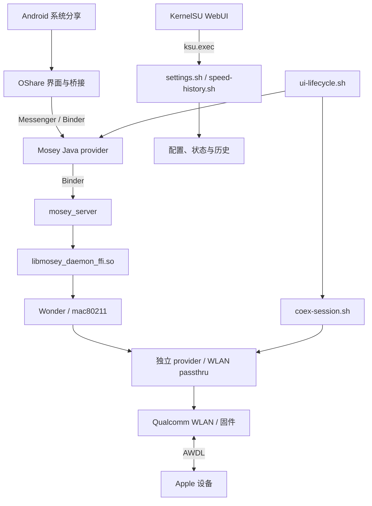
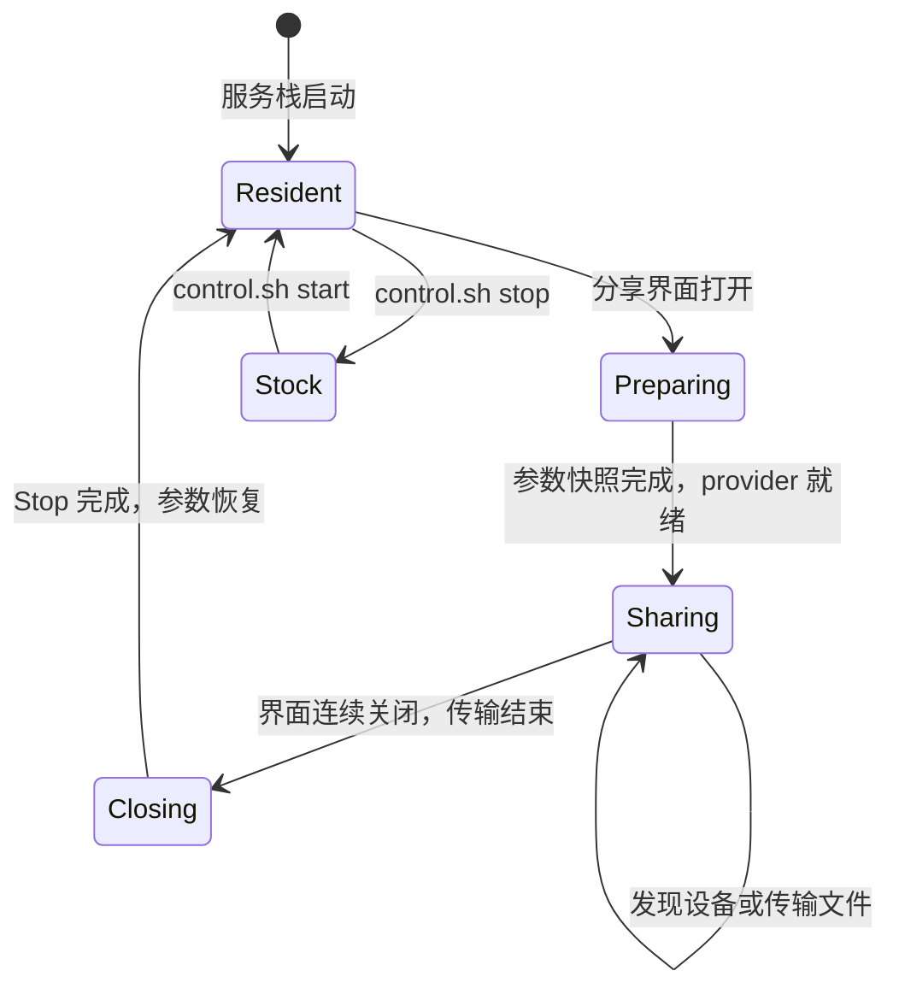

# 技术实现说明

Mosey 负责发现与传输协议，OShare 桥接把它接入系统分享界面。Wonder 和 WLAN 驱动负责收发无线帧，KernelSU 脚本管理服务启动、分享会话和退出恢复。

## 1. 总体架构



| 层 | 实现位置 | 职责 |
| --- | --- | --- |
| 分享入口 | `oshare/` | 设备列表、文件 URI、发送、进度、取消与设备展示 |
| Java 服务适配 | `mosey/` | 每次传输的回调归属、联网发现策略和传输状态跟踪 |
| 原生适配 | `native/` | Binder capability、FFI 配置、socket 缓冲和 Wi-Fi 会话元数据 |
| 无线适配 | `kernel/` | Wonder 绑定、passthru 会话、peer、管理帧 TX 与 native RX |
| 生命周期 | `module/bin/` | 驱动加载、provider 激活、共存参数、会话释放与配置持久化 |
| 管理界面 | `webui/` | 服务状态、共存开关、速度历史与日志 |

## 2. 启动与会话生命周期

### 2.1 服务栈启动

`module/service.sh` 等待 Android 开机完成，然后根据持久化的 `autostart` 标记调用 `control.sh start`。

启动流程：

1. 共用安装器的设备准入检测，只核对 Oplus 品牌、sun 平台与 6.6.118 内核基础版本，允许不同构建后缀；不限制型号、SDK、SoC 属性或原厂驱动身份。继续检查运行文件与原版 APK 版本。
2. 获取 `stack.flock`，记录本次启动的 boot ID 与 Wi-Fi 状态。
3. 暂停 Wi-Fi HAL，切换 WLAN 模块并加载独立 provider。
4. 恢复 HAL 与 Wi-Fi 状态，加载匹配的 `mac80211` 和 Wonder。
5. 通过 `LD_PRELOAD` 启动 `mosey_server`，等待 Binder 服务注册。
6. 完成原版 provider 认证与 callback APK 挂载。
7. 启动 `ui-lifecycle.sh` 与速度记录进程，写入监督器就绪状态。

Binder 服务名为：

```text
com.google.android.moseyservice.IMoseyService/default
```

启动完成后，驱动和原生服务进入驻留状态。分享界面的打开与关闭决定 provider 及无线会话的使用周期。

### 2.2 分享会话

`ui-lifecycle.sh` 从 `dumpsys activity activities` 识别前台 Activity。它跟踪 Quick Share 和 OShare 互传界面，并将同一分享任务中的文件选择器纳入会话。桥接 APK 无独立界面，管理入口为 KernelSU WebUI。



会话开始时，监督器取得 `settings.flock`，准备共存快照，再调用 `provider.sh ensure`。会话持续期间按周期确认 provider，并应用 Mosey socket 的缓冲配置。

界面连续三次被识别为关闭后，监督器检查 App 的传输状态，释放 Java provider，调用原生 Stop，并等待以下状态：

```text
opairshare_bridge_pending = 0
opairshare_channel_state: accepting=0 vdev=255 freq=0
opairshare_awdl_rx_mac_filter: used=0 armed=0 pending=0 active=0 fault=0
```

随后恢复 Wi-Fi 会话元数据和共存参数，删除 `ui-session`，回到驻留状态。界面关闭时仍有传输，监督器继续持有会话，直到传输终态出现。

### 2.3 服务栈停止

`control.sh stop` 按顺序停止监督器、Java provider 和原生服务，释放会话状态，卸载本次加载的模块，再加载设备原厂 WLAN 与 `mac80211`，恢复 Wi-Fi 状态。

`uninstall.sh` 调用相同的停止流程，并恢复 callback APK 挂载。调试时可通过 `control.sh start` 与 `control.sh stop` 管理服务栈。

## 3. OShare 分享桥接

LSPosed 模块的入口为 `Entry`，分别在两个进程中安装适配：

- `com.coloros.oshare`：在 `Application.attach` 后用 DexKit 解析并验证内部入口，再安装 `OShareBridge`，连接系统互传界面。
- `com.google.android.mosey`：获取 provider 的 ClassLoader，安装服务、发现频道和设备类型相关的 hook。

OShare 定位规则在 `OShareDexResolver` 中定义，`OShareApkFiles` 与 `OShareResolver` 负责 APK 指纹缓存，匹配缺失或有歧义时拒绝安装 hook。

### 3.1 命令与事件

主分享链路使用 `BridgeMessenger`。OShare 端传入客户端 `Messenger`，Mosey 端返回命令通道；命令调用 `ProviderApi`，发现与传输事件以 JSON 回送到界面。

源码中还保留了 `BridgeServer` 的本地 socket 通道实现，socket 名为 `oshare_airdrop_bridge`。当前系统互传入口使用 `BridgeMessenger`。

| 类 | 职责 |
| --- | --- |
| `ProviderHolder` | 保存 Mosey provider 使用的 ClassLoader |
| `ProviderApi` | 通过宿主类型和方法调用发现、广告、发送与取消接口 |
| `CallbackFactory` | 创建宿主回调接口的动态代理 |
| `BridgeMessenger` | 跨进程命令与事件通道 |
| `OShareBridge` | 系统分享 Intent、设备列表和传输交互映射 |
| `OutgoingTransfers` | 按目标设备管理发送任务与资源归属 |
| `AirDropPresentation` | 映射设备类型、图标和传输状态 |

### 3.2 文件与任务归属

OShare 桥接从 `ACTION_SEND`、`ACTION_SEND_MULTIPLE` 读取共享 URI、文本和文件显示名称，再向 Mosey 端提交发送请求。

`OutgoingTransfers` 为每次发送建立独立的 `Lease`。目标设备 ID 对应当前任务，任务终态按该 Lease 清理资源。这样同一设备在完成、取消和重试后的任务各自持有自己的回调与文件资源。

### 3.3 发现频道归一化

`DiscoveryChannels.select()` 根据会话 property、STA 连接状态和频率选择请求频道：

| 会话策略 | STA 频率 | AWDL 请求 |
| --- | --- | --- |
| `same149` | 5745 MHz | `[149]` |
| `cross5g`（历史兼容，当前模块不再启用） | 5200 MHz | `[149]` |

该逻辑将宿主国家码查询或频道回退结果与固定 149 的无线服务配置对齐，再交给 Mosey 的发现策略处理。

### 3.4 AirDrop 接收

OShare 接收使用独立的 `OShareReceiveResolver` / `OShareReceiveBridge`，在未导出的原生接收 Activity 中展示 COUI 界面；只对带本桥接 session 标记的实例跳过原协议生命周期。后台 Messenger 注册与命令入口校验 UID、Android 用户及注册客户端，重连后请求任务快照。

Mosey 中的 `ReceiveController` 在模块后台接收开启、root 共存准备就绪且接收 UI 已连接时取得广告与回调归属。保留原回调 / 下载目录，退出时恢复；已有原生接收任务时延迟接管。接收任务以每次 ASK 的单调请求 ID 和独立会话令牌关联，待确认、拒绝 / 取消清理、传输及发布均保留 busy 标记。

Mosey 的下载目录参数是公共 Downloads 下的目录名。本桥接使用 `.OPAirShare-incoming`，完成后按源文件实际长度复制到 MediaStore。原生小型文本文件自动转 TextAttachment 并删除原文件的分支，仅对当前桥接拥有的文件附件禁用，以保留字节与文件名。保存失败可重试，成功后提供授权 content URI。

WebUI 的 `receive-directory-set <UTF-8 hex>` / `receive-directory-reset` 通过 Settings.Global `opairshare_receive_directory_hex` 设置完成文件目录。状态字段为 `receive_directory`；空值沿用原先 Pictures / Movies / Download 下的 OPAirShare 分类。自定义目录限定为 Download 或 Documents 及其非隐藏子目录，经 MediaStore.Files 发布整批文件。Java、WebUI 与 shell 校验 UTF-8、字节长度、目录分段和路径跳转；每批发布开始时读取一次配置，已有文件不移动，Mosey 暂存目录不变。完成事件携带 MediaStore 返回的实际文件名、目录及可授权 URI。

`ui-lifecycle.sh` 同时管理发送界面和后台接收需求。从 1.0.11 起，后台接收由模块与共存开关控制，独立于 oshare_state 和原生时限。OShare 宿主通过模块拥有的前台服务代理保持运行；撤销新邀请不释放忙碌的接收宿主，确认空闲后才释放代理。相关主机回归位于 `tests/test_receive_lifecycle.py`；目前真机已验证 Mac 发送文本文件、接收确认、保存及 SHA256 一致，其他场景仍待验证。

### 3.5 原生 Seedling 接收展示（1.0.13）

接收宿主异步解析独立 Seedling 能力，读取手机原始签名 UPK 的 index 页面默认数据和动作契约。`OShareNativeTransferPresenter` 将现有接收快照映射为原生卡片数据，串行后台调用 SDK START / update / END，真实卡片版本与实例创建确认后接管进度呈现，失败保留原弹窗和通知。发送共用同一生命周期并使用独立实例，详见 [发送流体云说明](OSHARE-NATIVE-SEND-IMPLEMENTATION.md)。

原生 progress widget 的 `cancel` 带 instanceId，可映射到当前阶段的取消或查看。每次交互意义切换轮换实例，退休实例仍被识别并消耗，避免动作落入原协议单例。现有通知保留为卡片关联的底层通知，交由 Seedling 的 notificationIdList 协调呈现；完成后继续提供会话文件入口。

`ReceiveUiPolicy` 仅在已知会话从未发布转为 complete + terminal + published 时触发完成弹窗，不重放历史结果。原生进度只收起非终态、非手动打开的对话框；保存成功后自动重新打开完成界面，保留“完成 / 打开文件”及实际目录。锁屏、原生 OShare 接收占用或另一个活跃接收界面存在时保留通知入口，不抢占界面。

基线原始确认按钮没有实例标识，因此隐藏这些原生按钮，邀请确认保留现有安全弹窗。原生接收控制器不参与 AirDrop 传输；模板不改写、不绕过签名。见 [实现范围](OSHARE-NATIVE-RECEIVE-IMPLEMENTATION.md)。

### 3.6 AirDrop 名称

WebUI 的 `name-set <UTF-8 hex>` / `name-reset` 独立于无线参数修改，不要求关闭接收会话。后端校验 UTF-8、控制字符和 64 字符上限，将十六进制值写入 Settings.Global 的 `opairshare_airdrop_name_hex`，状态返回当前生效配置、自定义值和默认属性值。输入从不作为 shell 源码解释。

`AirDropName` 使用同样的 UTF-8 / 字符校验；默认读取 `ro.vendor.oplus.market.enname`，依次回退 `Build.MODEL`、`OPAirShare`。发送时即时读取名称；`ReceiveController` 在没有待确认 / 活动接收或发送时通过 Mosey UpdateAdvertising 更新广播，失败稍后重试。设置保存读回成功表示配置已持久化，Apple 列表实际刷新受协议更新与对端缓存影响。

1.0.6 构建已完成；按用户要求停止后续测试，尚未部署或验证手机改名效果。

## 4. Mosey APK 适配

### 4.1 每次传输的 callback

callback 构建器修改 `classes2.dex` 中的四个类型：

| 类型 | 改动 |
| --- | --- |
| `dly` | 使用原有的 per-transfer callback 分支 |
| `ccu` | 提供 `opairshareTransferCallback()`，读取该传输对象保存的 callback |
| `cee` | 在 coroutine continuation 中保存 callback |
| `cen` | 在终态重建与异步恢复中使用保存的 callback |

callback 跟随具体传输对象与 continuation，进度、取消和终态更新由同一任务的 callback 接收。

### 4.2 联网发现策略

发现构建器在 `byt` 的 Wi-Fi 策略调用点引入 `DiscoveryPolicy.keepWifi()`。策略读取 `debug.opairshare.discovery`，检查 Wi-Fi 启用状态、`COMPLETED` 连接状态、当前频率及单频道 `[149]` 请求。

验证后的连接信息记录为本次发现会话的 network ID 与频率。network ID 可见时用于比对网络身份，频率和连接状态用于后续发送与接收检查。

`--transfers` 构建选项还会集成以下调用点：

- 原接收请求完成 Accept 校验后，调用 `beginTransfer()`。
- 显式发送前调用 `beginTransfer()`，发送调用返回后记录 `sendResult()`。
- 传输 metadata 更新时调用 `onMetadata()`，在终态释放该目标的传输归属。

`DiscoveryPolicy` 用目标 ID 集合记录活动传输，支持多个目标同时持有状态。`--standby` 选项对应源码中的广告可见性扩展，由独立 property 控制。

### 4.3 原版认证与延迟挂载

`callback-bootstrap.sh` 先恢复原版 APK 视图，激活原版 provider，并等待 GMS 的服务记录出现 Mosey 注册条目。认证完成后，释放 provider，再由 `callback.sh` 挂载构建后的 APK。

callback 管理在系统 mount namespace 中执行，并记录系统 APK 与当前活动 APK 的挂载路径和 boot ID。`app-check.sh` 根据启动阶段检查原版或补丁版 APK。

## 5. 原生适配层

### 5.1 Binder capability

`libopairshare_capability.so` 拦截 `AIBinder_Class_define()`，在 Mosey 的 Binder 类上替换 transaction handler。transaction code 4 返回一个非空 stable parcelable，其 capability protobuf 的 field 1 为 `false`。其他 transaction 调用原 handler。

这一层将 capability 查询的返回格式与当前原生服务接口对齐。

### 5.2 FFI 配置

`libopairshare_config.so` 通过 `dlsym()` 获取原 `mosey_start_5`，在 `OPAIRSHARE_ENABLE_HOPPING=1` 时安装包装函数。包装函数在配置 protobuf 后追加 field 5 的 `true` 值，并根据 `OPAIRSHARE_SOCIAL_CHANNELS` 选择频道集合。

运行脚本使用：

```text
OPAIRSHARE_ENABLE_HOPPING=1
OPAIRSHARE_SOCIAL_CHANNELS=149
OPAIRSHARE_CONFIG_TRACE=/data/adb/opairshare/config-trace.log
```

包装函数处理配置后继续调用原 `mosey_start_5`，协议实现由原 FFI 库执行。

### 5.3 socket 缓冲

`opairshare-socket-buffer` 使用 `pidfd_open` 和 `pidfd_getfd` 访问指定 Mosey 进程的 socket。匹配条件为：

- 进程命令名为 `com.google.android.mosey`。
- socket 类型为 TCP stream。
- 本地与对端地址均为 IPv6 link-local。
- 本地 scope ID 对应当前 `mosey0`。

`--apply` 将匹配连接的 `SO_SNDBUF` 请求值收敛到 65536 字节；Linux 读回值通常为请求值的两倍。监督器周期性运行该助手，作用范围为当前 Mosey 连接。

### 5.4 Wi-Fi 会话元数据

`OPAirShareSessionWifi` 通过 `app_process` 调用 Android Wi-Fi API，记录 boot ID、network ID 与 autojoin 状态，并在会话结束时恢复。

共存会话直接保持 STA 连接；采用原发现路径的会话由该助手保存并恢复 Wi-Fi 元数据。

## 6. 无线驱动适配

SM8750 平台的实现过程、关键接口和研发结果见 [在 SM8750 原厂固件上实现 AWDL](SM8750-AWDL.md)。

### 6.1 Wonder 与独立 provider

Wonder 向原生服务提供无线接口，底层使用 `mac80211` 与平台 passthru 操作。

`opairshare_wonder_provider` 通过 Linux component 框架暴露绑定点，导出 `cnss_set_vendor_wonder_priv_data()`，将 WLAN 提供的操作表交给 Wonder。它作为独立模块与设备原有 CNSS 服务共同组成绑定关系。

### 6.2 TX 路径

管理帧和 AWDL 数据桥由 `wma_opairshare_pas_mgmt.h` 等文件实现，包含异步工作队列、vdev 生命周期、peer 归属、发送完成与队列计数。

主要模块：

| 文件 | 作用 |
| --- | --- |
| `wma_opairshare_pas_mgmt.h` | 管理帧发送与异步 bridge 队列 |
| `wma_opairshare_awdl_target.h` | 从会话学习 peer 并管理目标上下文 |
| `wma_opairshare_awdl_sequence.h` | AWDL 发送序号管理 |
| `wma_opairshare_flow_control.h` | 队列容量与发送背压 |
| `wma_opairshare_channel_state.h` | 无线会话与频道状态 |

`turbo.sh` 的 `fast` 配置使用 VHT MCS8、2SS、最多 5 个 MSDU、7935 字节聚合上限和 1000 微秒收集窗口，带宽设为 20 MHz。配置通过 `passthru_awdl_*` 模块参数传入驱动。

### 6.3 RX 路径

RX 实现同时涉及辅助 monitor、固件接收 matcher、RAW 帧投递和 native REO 数据路径。

| 文件 | 作用 |
| --- | --- |
| `wlan_hdd_opairshare_aux_rx.h` | 辅助 monitor 与目标接口转发 |
| `wma_opairshare_awdl_rx_mac_filter.h` | matcher 创建、固件响应与会话释放 |
| `wma_opairshare_native_rx_work.h` | 将 native RX ring 激活安排到异步工作队列 |
| `wlan_hdd_opairshare_rx_ring_switch.h` | 会话持有期间选择接收 ring |
| `dp_be_rx.c`、`dp_rx.c`、`dp_rx_err.c` | native 数据路径中的 RAW 帧接纳与投递 |
| `wlan_hdd_opairshare_awdl_rx_dedup.h` | 接收重复帧处理 |
| `wlan_hdd_opairshare_rx_order.h` | 可配置的主机接收排序辅助 |

native RX 工作项绑定当前 vdev 与 peer，执行时检查 bridge 的会话状态。正常 Stop 与实际 vdev 删除完成后，matcher 进入下一次会话可重新启用的状态。

## 7. Wi-Fi 共存

`coex-session.sh` 在本次分享会话中持有驱动参数和 property 的快照。

| STA | 策略 property | 本次会话配置 |
| --- | --- | --- |
| 5745 MHz | `same149` | 同信道发现，沿用当前 TX profile |

当前仅启用 `same149`，设置 `passthru_awdl_allow_concurrent` 与 `passthru_mgmt_home_channel`，AWDL 使用 5745 MHz。

prepare 先将 boot ID、STA 频率、原 property 和七个驱动参数写入 `coex-session.preparing/`，再通过目录重命名提交为 `coex-session/`，随后应用会话配置。tick 根据活动 channel 和 matcher 状态选择 native RX ring。restore 在无线会话释放后写回快照，并将记录归档为 `coex-session.restored-*`。

`scope=auto` 与 `scope=same149` 均只允许 STA 5745 MHz；保留旧枚举用于配置兼容。

`coex-wifi.sh` 通过有超时的 `cmd wifi status` 查询确认 Wi-Fi 启用、已连接、Supplicant COMPLETED、频率 5745 MHz 和 network ID。监督器每轮检查（正常循环约 1 秒，另加命令耗时），发现断线、非 149 或状态不可读时写入独立的 `coex-wifi-blocked` 暂停标记；不改写用户的 `coex-off`。同信道 network ID 改变、断线或频率变化会将已有共存会话标为 `invalidated`。

失效会话立即关闭接收准入，等待 provider 确认无待确认邀请、传输或文件发布，再按 provider release → native Stop → 驱动空闲确认 → 参数恢复释放，即使分享页面仍在前台也会执行。回到 149 后重新准备共存；同信道换网络也重建会话。非 149 下前台分享沿用非共存流程，回到 149 时先安全释放旧会话及 Wi-Fi 元数据，再升级为共存；Wi-Fi 状态不可读时不自动启动非共存流程。手动关闭不会自动恢复。此恢复不保证无线变化时已有传输不中断。

接收 `ready` 再次查询当前连接，检查暂停/失效标记及 network ID，避免准备与广播之间的网络变化直接开放准入。`settings.sh status` 的 `coexist` 表示当前可用策略，`coexist_requested` 保存用户开关，`coexist_reason` 说明暂停原因；WebUI 使用 requested 保存设置，避免把暂时暂停误存为永久关闭。

## 8. 状态与并发管理

状态根目录为 `/data/adb/opairshare`。boot ID、进程身份与会话文件共同描述运行归属。

| 状态 | 用途 |
| --- | --- |
| `stack-boot` | 当前服务栈所属的 boot |
| `server.pid`、`server-boot` | 原生服务进程身份 |
| `supervisor.pid`、`supervisor-ready` | 界面监督器与就绪状态 |
| `ui-session` | 当前分享界面的会话归属 |
| `coex-session/` | 共存参数快照 |
| `session-wifi` | 原发现路径的 Wi-Fi 元数据 |
| `callback/`、`callback-auth/` | APK 挂载与 provider 认证记录 |
| `autostart`、`turbo-*`、`coex-*` | 持久化偏好 |
| `speed-history/` | 实时速度与历史记录 |

并发操作通过 flock 协调：

| 锁 | 持有者 |
| --- | --- |
| `stack.flock` | 服务栈操作与设置保存 |
| `provider.flock` | 界面监督器 |
| `settings.flock` | 设置保存与共存会话准备 |
| `callback/operation.flock` | callback 挂载操作 |
| `speed-history/worker.flock` | 速度记录进程 |

`settings.sh apply` 保存前记录标记文件与驱动参数；写入中断或返回错误时按快照恢复。WebUI 在保存后重新读取状态，对照目标配置。

## 9. WebUI 与管理 API

前端使用 Vue 3.5.38、miuix-vue 0.1.1 和 Vite。底栏包含状态与设置两个页面：

- 状态：AWDL、QuickShare、OShare 状态，实时发送/接收速度与历史列表。
- 设置：Wi-Fi 共存开关、关于、日志查看与导出。

`webui/src/api.ts` 使用 KernelSU 的 `window.ksu.exec` 调用固定后端命令。每次请求使用独立的 JS callback key，在回调或超时后清理。

| 接口 | 命令 | 返回 |
| --- | --- | --- |
| 状态 | `settings.sh status` | 配置、进程与驱动状态 JSON |
| 保存 | `settings.sh apply <coexist> <scope> <profile> <autostart>` | 保存后的状态 JSON |
| 共存开关 | `settings.sh coexist on/off` | 保留其他配置，经过原保存检查后返回状态 JSON |
| 即时计数 | `settings.sh speed` | 接口字节数、ifindex 与采样时钟 |
| 历史 | `speed-history.sh status` | `recorder`、`live` 与 `history` |
| 日志 | `settings.sh logs` | 最近启动和监督器日志 |
| 导出 | `settings.sh export-logs` | 导出文件路径 JSON |

配置枚举为：

```text
coexist:  on | off
scope:    auto | same149
profile:  fast | vht | on | off
autostart: on | off
```

共存开关由后端读取当前 scope、profile 和 autostart，复用 `apply` 的锁与传输安全检查。配置和名称保存直接验证后端返回的状态 JSON，每次保存只调用一次 root bridge。`awdl` 状态由驱动参数节点和原生服务进程生成；QuickShare 与 OShare 优先检查运行进程，未运行时查询安装信息。状态 JSON 由 `webui-status.sh` 一次序列化，保留字符串转义；原始 `radio`、`matcher`、`pending` 字段用于描述无线会话。

界面可见时，实时速度每秒刷新，完整状态每五秒刷新；切页复用近期状态，未变化的历史列表不重建。后台查询和保存使用独立的忙状态，查询期间仍可操作设置；保存会使此前未完成的状态请求失效，避免旧结果覆盖保存结果。开关立即展示待保存值，保存失败时回到已确认值；切页不再等待旧页面淡出。

## 10. 速度历史

`speed-history.sh` 是由监督器启动的独立后台进程，每 500 毫秒读取：

```text
/sys/class/net/mosey0/ifindex
/sys/class/net/mosey0/statistics/tx_bytes
/sys/class/net/mosey0/statistics/rx_bytes
```

采样间隔使用 `/proc/uptime`，展示时间使用 Unix 时间戳。速率单位为字节/秒，前端按十进制 MB/s 展示。

记录规则：

- 接口首次出现、ifindex 变化或计数重置时建立新的采样基线。
- 累计数据变化时更新发送/接收字节数、峰值和平均速率。
- 每秒查询 provider 的传输状态。桥接观察 OShare / Quick Share 的发送、接收回调，并输出 `OPAIRSHARE_HISTORY state=waiting|active|idle`；连接、等待本机确认及等待对方接受不启动记录，且不累计这些阶段的握手流量。发送进入传输状态、接收成功接受后开始计时；确认空闲时结算，保留结束采样中的最后一批数据，之后的发现流量不再累计。
- provider 保持传输或文件保存状态时，零流量暂停不会拆分记录。状态未知时沿用流量采样，连续 6 秒无数据、接口重建或进程退出时结算。
- 确认的传输记录标记为 `transfer`；provider 状态未知时的流量记录标记为 `traffic`，累计流量达到 65536 字节后保存。
- `records.jsonl` 保留最近 100 条，通过临时文件和重命名提交。

统计包含计时范围内接口上的协议流量，同一传输期间的并发文件合并统计；平均速率与用时使用同一范围。接受后的暂停、校验及接收文件发布继续计入用时。等待中拒绝或超时不保存传输记录。传输用时按采样到的活动状态计算，边界精度受每秒状态查询和 dumpsys 耗时影响；等待期间状态查询失败时继续排除等待，桥接阶段观测不可用时回退原 provider 状态判断。其他未知状态下的流量用时以最后一次数据变化作为结束时间。实时速率独立于传输确认状态；记录进程检测只匹配脚本路径，避免 `/proc/PID/cmdline` 的 NUL 参数分隔符导致误报停止。旧记录缺少确认及传输阶段边界，无法事后扣除等待时间。

## 11. 代码阅读顺序

1. `module/bin/control.sh`：服务栈与原厂恢复。
2. `module/bin/ui-lifecycle.sh`、`coex-session.sh`：分享界面与无线会话。
3. `oshare/app/src/main/java/com/tlsu/oshareairdrop/Entry.java`、`ProviderApi.java`：分享入口到 provider。
4. `mosey/callback/build.py`、`mosey/discovery/DiscoveryPolicy.java`：回调归属与联网发现。
5. `native/config.c`、`capability.c`：原生接口适配。
6. `kernel/provider/provider.c` 与 `kernel/driver/wma_opairshare_pas_mgmt.h`：无线绑定和数据路径。
7. `module/bin/settings.sh`、`speed-history.sh` 与 `webui/src/api.ts`：管理接口与界面。

其他设备的适配步骤见 [平台迁移指南](PORTING.md)。
